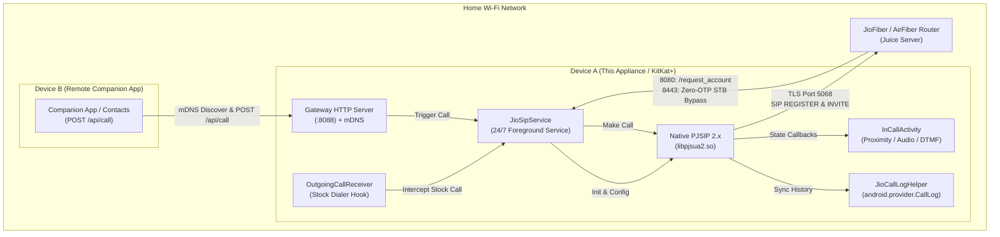

# Jio Landline Calling Appliance & Remote Gateway

[%20to%2014+-3DDC84.svg?logo=android&logoColor=white)](https://developer.android.com)
[](https://developer.android.com/about/dashboards)
[](https://developer.android.com/ndk)
[](https://www.pjsip.org/)
[](LICENSE)

An open-source Android application designed to repurpose any spare or older Android smartphone into a **dedicated, always-on landline phone and remote calling gateway** for **Reliance JioFiber and AirFiber** connections.

---

## Table of Contents
- [Motivation & Problem Statement](#motivation--problem-statement)
- [Key Features](#key-features)
- [System Architecture](#system-architecture)
- [Jio IMS Protocol & Quirks](#jio-ims-protocol--quirks)
- [Remote Gateway REST API](#remote-gateway-rest-api)
- [Project Structure](#project-structure)
- [Hardware & Software Requirements](#hardware--software-requirements)
- [Building from Source](#building-from-source)
- [Installation & First-Time Setup](#installation--first-time-setup)
- [Troubleshooting & FAQ](#troubleshooting--faq)
- [Security & Privacy](#security--privacy)
- [Credits & Acknowledgements](#credits--acknowledgements)
- [Disclaimer](#disclaimer)

---

## Motivation & Problem Statement

Reliance Jio provides landline calling over home fiber/fixed-wireless connections via their official **JioJoin** (formerly JioCall) application. However, using the official app comes with several challenges:

1. **Deprecated on Older Hardware**: The official app drops support for older Android versions, leaving older devices as e-waste.
2. **Aggressive Battery Drain & Sluggishness**: Built with heavy cross-platform frameworks, eating 150MB–250MB+ of RAM and frequently crashing in the background.
3. **Flaky Background Registration**: Modern Android battery management often kills the background service, causing missed landline calls.
4. **No Native Hardware Feel**: Cannot seamlessly hook into the phone's stock native dialer or sync directly with the native Android call log.

### The Solution
This project strips away all bloat and implements a lightweight, native C++ **PJSIP (Pjsua2)** SIP client paired with an ultra-efficient Android foreground service. It:
* Runs on **Android 4.4 KitKat (API 19)** through **Android 14+ (API 34+)**.
* Has a memory footprint of just **~25MB–35MB RAM**.
* Auto-starts on boot to operate 24/7 as an unkillable home landline appliance.
* Exposes a built-in **HTTP REST API & mDNS discovery** so modern companion phones on the same Wi-Fi can trigger landline calls remotely without audio bridging.

---

## Key Features

* **Zero-Touch Provisioning (Zero-OTP)**:
  * Discovers the Jio router automatically on the local Wi-Fi subnet (`192.168.29.1`).
  * Simulates a Jio Set-Top Box (`nwk_intf=eth`) on port `8443` to retrieve SIP authentication credentials instantly with **no SMS OTP required**.
  * Also supports Permanent Wi-Fi mode (`nwk_intf=wifi`) with SMS OTP verification if required.
* **Always-On Appliance Reliability**:
  * Autostarts on boot (`RECEIVE_BOOT_COMPLETED`).
  * Maintains continuous Wi-Fi connection and CPU keepalive using `WifiLock` (High-Perf) and `WakeLock`.
  * Automatic SIP re-registration with aggressive keepalive timers.
* **Stock Hardware Dialer Hook**:
  * Intercepts dialed numbers directly from the phone's native dialpad (`NEW_OUTGOING_CALL`).
  * Cancels the cellular radio attempt and routes the call cleanly through the Jio landline line.
* **Native System Call Log Integration**:
  * Automatically writes incoming, outgoing, and missed calls directly into Android's native `CallLog.Calls` database.
* **Remote Gateway Server (Port 8088)**:
  * Built-in lightweight zero-dependency HTTP server with CORS support.
  * Advertises via native mDNS (`_jiolandline._tcp.`).
  * Enables remote companion apps (Device B) to pair via a 4-digit PIN, inspect battery/network status, and trigger outgoing calls.
* **Modern In-Call Experience**:
  * Screen wakes and displays over lock screen (`FLAG_SHOW_WHEN_LOCKED`, `FLAG_TURN_SCREEN_ON`).
  * In-call controls: Speakerphone toggle, microphone mute, in-call DTMF dialpad, and call timer.
  * Proximity sensor integration automatically turns off the screen when the phone is held to the ear.
* **Strict Jio IMS SIP Quirk Handling**:
  * Enforces the non-standard `+sip.instance` format without `urn:uuid:`.
  * Mandatory prioritization of **AMR-WB (16,000 Hz)** and **AMR-NB (8,000 Hz)** codecs.
  * Handles Digest MD5 authentication and SIP over TLS on port `5068`.

---

## System Architecture



---

## Jio IMS Protocol & Quirks

Connecting to a JioFiber ONT requires handling specific proprietary quirks implemented in the router's internal VoIP daemon (the **Juice Server**):

### 1. Router Endpoints
* **HTTP `8080` (`/request_account`)**: Returns account metadata in JSON format containing `msisdn` (landline number), `imsi`, `mcc` (405), `mnc` (874), and line status.
* **HTTPS `8443` (`/`)**: Credentials distribution service. Uses legacy self-signed certificates and older SSL/TLS ciphers.
* **SIP TLS `5068`**: Internal SIP proxy routing directly to Jio's IMS core (`wb.wln.ims.jio.com`).

### 2. Zero-OTP Ethernet Mode Bypass (`nwk_intf=eth`)
Normally, Wi-Fi requests (`nwk_intf=wifi`) trigger an SMS OTP to the account holder's registered mobile number. However, simulating a wired Jio Set-Top Box by passing `nwk_intf=eth` causes the Juice server to **completely bypass OTP verification**, returning the XML provisioning document (`wap-provisioningdoc`) containing the SIP username, password, realm, and outbound proxy immediately.

### 3. Virtual MAC & Instance UUID Calculation
The router validates that requests come from a whitelisted virtual MAC. The MAC is deterministically derived from the client's device hostname using DJB2-style hashing:

```java
int h = 0;
for (byte b : hostname.getBytes("UTF-8")) {
    h = ((h * 33) + b) & 0xFFFFFFFF;
}
byte b0 = (byte) (h & 0xFF);
byte b1 = (byte) ((h >> 8) & 0xFF);
byte b2 = (byte) ((h >> 16) & 0xFF);
byte b3 = (byte) ((h >> 24) & 0xFF);

String mac = String.format("00:00:%02x:%02x:%02x:%02x", b0, b1, b2, b3);
String uuid = String.format("00000000-0000-1000-8000-0000%02X%02X%02X%02X", b0, b1, b2, b3);
```

### 4. Non-Standard `+sip.instance` Header
* Standard RFC 5626 format: `+sip.instance="<urn:uuid:00000000-...>"`
* **Jio Juice requirement**: The router strictly rejects `urn:uuid:` with a `401 Unauthorized`. It expects:
  ```http
  +sip.instance="<00000000-0000-1000-8000-0000AABBCCDD>"
  ```
  This must be present on **all** `REGISTER` and `INVITE` contact headers.

### 5. Mandatory Audio Codecs
Jio's core network rejects or silences standard G.711 PCMA/PCMU audio after ~30 seconds. The client must prioritize:
1. **AMR-WB (16,000 Hz / Wideband)**
2. **AMR-NB (8,000 Hz / Narrowband)**

---

## Remote Gateway REST API

When running as an appliance, the app exposes an HTTP REST API on port `8088` and advertises itself via Android mDNS (`_jiolandline._tcp`).

### 1. Discovery (`mDNS`)
* **Service Type**: `_jiolandline._tcp.`
* **Service Name**: `JioLandline-Gateway`
* **Port**: `8088`
* **Attributes**: `version=1.0`, `device=<Manufacturer> <Model>`

### 2. Endpoints

#### `GET /api/status`
Returns real-time gateway status, battery, and call state. No authentication required.
```json
{
  "status": "IDLE",
  "registered": true,
  "msisdn": "+91XXXXXXXXXX",
  "activeCallNumber": null,
  "batteryLevel": 98,
  "isCharging": true,
  "wifiSsid": "MyJioFiber_5G",
  "deviceModel": "Xiaomi Redmi 2",
  "port": 8088,
  "pairedDevices": 1,
  "timestamp": 1731600000000
}
```

#### `POST /api/pair`
Pairs a new companion client using the 4-digit PIN shown on the gateway screen.
* **Request**:
  ```json
  {
    "pin": "4821",
    "clientName": "Pixel 8 Pro"
  }
  ```
* **Response (200 OK)**:
  ```json
  {
    "status": "PAIRED",
    "token": "d8f3a9e14c2b...",
    "msisdn": "+91XXXXXXXXXX",
    "deviceModel": "Xiaomi Redmi 2"
  }
  ```

#### `POST /api/call`
Initiates an outbound landline call. Requires `X-Gateway-Token` header.
* **Headers**: `X-Gateway-Token: <token>`
* **Request**:
  ```json
  {
    "number": "+919876543210"
  }
  ```
* **Response (200 OK)**:
  ```json
  {
    "status": "CALLING",
    "number": "+919876543210"
  }
  ```

#### `POST /api/hangup`
Terminates the active landline call. Requires `X-Gateway-Token` header.
* **Headers**: `X-Gateway-Token: <token>`
* **Response (200 OK)**:
  ```json
  {
    "status": "HANGUP_REQUESTED"
  }
  ```

---

## Project Structure

```
android-app/
├── app/
│   ├── build.gradle              # Android build configuration (minSdk 19, targetSdk 22)
│   └── src/main/
│       ├── AndroidManifest.xml   # Permissions, activities, receivers, and service declaration
│       ├── jniLibs/              # Compiled PJSIP native binaries
│       │   ├── armeabi-v7a/      # libpjsua2.so, libc++_shared.so (32-bit ARM)
│       │   └── x86/              # libpjsua2.so, libc++_shared.so (x86 Emulator/devices)
│       ├── java/
│       │   ├── com/jio/calling/
│       │   │   ├── audio/        # JioAudioManager: Speaker, Mute, Proximity sensor lock
│       │   │   ├── gateway/      # GatewayServer: HTTP server (:8088), Auth & mDNS
│       │   │   ├── model/        # JioAccount, RouterInfo data models
│       │   │   ├── provisioning/ # Zero-OTP STB bypass, router discovery, TLS factory
│       │   │   ├── receiver/     # OutgoingCallReceiver (stock dialer hook), BootReceiver
│       │   │   ├── service/      # JioSipService (24/7 background foreground service)
│       │   │   ├── sip/          # JioSipManager (PJSIP lifecycle, call listeners, codecs)
│       │   │   ├── ui/           # MainActivity, InCallActivity, IncomingCallActivity
│       │   │   └── util/         # JioCallLogHelper (Android native CallLog sync)
│       │   └── org/pjsip/pjsua2/ # PJSIP Java SWIG wrappers
│       └── res/                  # Layouts, drawables, colors, styles
├── build.gradle                  # Top-level build script
└── settings.gradle               # Gradle project settings
```

---

## Hardware & Software Requirements

| Requirement | Minimum Specification | Recommended |
|---|---|---|
| **Android OS** | Android 4.4 KitKat (API 19) | Android 4.4 to Android 10 |
| **Processor Arch** | `armeabi-v7a` or `x86` | 32-bit ARM Cortex |
| **RAM** | 512 MB | 1 GB or more |
| **Network** | Wi-Fi 2.4 GHz or 5 GHz | Static local IP / strong 5 GHz signal |
| **Router** | JioFiber ONT / Jio AirFiber Gateway | Voice service enabled on fiber subscription |

---

## Building from Source

### 1. Prerequisites
* **Android SDK**: Build Tools `33.0.0` or higher.
* **JDK**: OpenJDK 8, 11, or 17 (Java 8 bytecode compatibility).
* **Prebuilt Native Binaries**: Included out-of-the-box in `app/src/main/jniLibs/` (`libpjsua2.so` and `libc++_shared.so`).

### 2. Build the Debug APK
Clone the repository and build using Gradle:

```bash
cd android-app
./gradlew assembleDebug
```
The output APK will be placed at:
```
app/build/outputs/apk/debug/app-debug.apk
```

### 3. (Optional) Recompiling Native PJSIP
If you want to recompile the native PJSIP libraries yourself with customized build flags or additional codecs, refer to the automated build scripts and documentation located in the [`../ndk-build/`](../ndk-build/) directory.

---

## Installation & First-Time Setup

1. **Install APK**:
   ```bash
   adb install -r app/build/outputs/apk/debug/app-debug.apk
   ```
2. **Connect to Wi-Fi**:
   Connect the phone to your home JioFiber / AirFiber Wi-Fi network.
3. **Launch the App**:
   * Open **Jio Landline**.
   * The app automatically discovers the router at `192.168.29.1` and performs the Zero-OTP Ethernet mode bypass.
   * Within seconds, your landline number (`msisdn`) will appear on the dashboard, and the status will transition to **Registered (200 OK)**.
4. **Appliance Configuration Tips**:
   * **Keep Wi-Fi Active**: In Android *Settings > Wi-Fi > Advanced*, set *Keep Wi-Fi on during sleep* to **Always**.
   * **Battery Optimization**: Exclude Jio Landline from any OS-level battery saver or task-killing apps.
   * **Screen Lock**: Set lock screen security to **None** or **Swipe** for instantaneous call answering.

---

## Troubleshooting & FAQ

#### Q: The app says "Router not reachable (timeout)".
* Ensure the phone is connected to the primary Wi-Fi network of your JioFiber ONT, not a guest network or separate sub-router without access to `192.168.29.1`.
* Try pinging `192.168.29.1` from a terminal or visiting `http://192.168.29.1:8080/request_account` in the phone's browser.

#### Q: Registration fails with `401 Unauthorized`.
* Verify that your JioFiber subscription has active landline calling enabled.
* Make sure your router firmware hasn't disabled local SIP access.

#### Q: Call connects, but there is no audio or the call drops after 30 seconds.
* Jio IMS strictly requires AMR-WB or AMR-NB codecs. If your device's audio hardware has problems with 16kHz sampling, check that AMR-NB (8kHz) fallback is enabled in `JioSipManager`.

#### Q: Companion app cannot discover the Gateway.
* Ensure both devices are on the same Wi-Fi subnet.
* Ensure **AP Isolation** (Client Isolation) is disabled in your router settings, as it blocks multicast mDNS and local HTTP communication between devices.

---

## Security & Privacy

* **100% Local**: No external analytics, cloud servers, or third-party tracking. All communication is strictly confined to your home local area network.
* **Encrypted SIP**: SIP signaling to the router is TLS-encrypted on port `5068`.
* **PIN-Protected API**: Remote trigger endpoints (`/api/call`, `/api/hangup`) require a cryptographically secure token obtained by physically verifying the 4-digit PIN on the appliance screen.

---

## Credits & Acknowledgements

* **[PJSIP / Teluu](https://www.pjsip.org/)**: For the rock-solid open-source multimedia communication library and `pjsua2` framework.
* **[JFC-Group (JioFiber Customisation Group)](https://github.com/JFC-Group)**: For their reverse-engineering work on the router's Juice server protocol, virtual MAC algorithms, and Zero-OTP bypass techniques.
* **[JFC-RusTone](https://github.com/JFC-Group/JFC-RusTone)**: For reference implementations of Jio SIP instance headers.

---

## Disclaimer

This is an independent open-source research and home automation project developed for educational and accessibility purposes. It is **not** an official product of, nor is it endorsed, sponsored, or affiliated with **Reliance Jio Infocomm Ltd.** "Jio", "JioFiber", "AirFiber", and related trademarks are the property of their respective owners.
